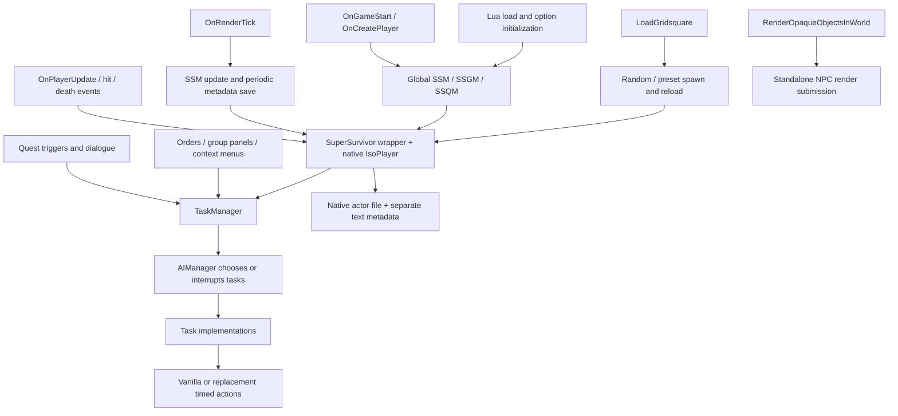

# Whole-codebase port review — 10 November 2026

Implementation follow-up: [development scenarios](DEVELOPMENT_SCENARIOS.md)
records repairs to task cancellation (R05), patrol endpoints (R11), inventory
transfer sequencing (R13), the forced self-treatment fallback (R14), nearest
patient selection, and removal of the obsolete disinfection override (R07).
The findings below describe the original audit snapshot; not every related
subsystem issue is resolved. Native in-game station results remain pending.

## Assessment

The remaining port is a behavioral and ownership port, not primarily a search-and-replace exercise. Much of the obvious B41 API vocabulary has already been repaired. The most consequential remaining problems are the use of standalone `IsoPlayer` objects as NPCs, split persistence with an unreliable location index, global replacements of vanilla behavior, and inconsistent task lifecycle rules. Ordinary Lua logic bugs also survive independently of B42.

This is an analysis snapshot of the working tree, including existing uncommitted changes. No runtime source was changed by this review. The companion [file guide](FILE_GUIDE_2026-11-10.md) describes every runtime Lua file, map script, and supporting repository category.

Target examined: locally installed **42.22.2**, revision **3d39148846**, under `G:/Steam/steamapps/common/ProjectZomboid`. The development installation links `42` and `common` directly to this repository. `versionMin=42.15` in `42/mod.info` is a declared minimum, not evidence that all versions from 42.15 work.

Evidence labels below:

- **Confirmed:** follows directly from executable code or an isolated reproduction.
- **Compatibility risk:** current implementation crosses an engine/subsystem boundary; full gameplay consequences require integration testing.
- **Historical/live evidence:** observations and native-code inspection from the existing debugging work; this audit did not run a new world.

Priority P1 means fix before treating normal play/saving as reliable; P2 means a feature is broken or unsafe under a specific trigger; P3 means narrower correctness/maintenance work. There is no claim that every branch of the approximately 28,000 lines has been dynamically exercised.

## Architecture and reading order

Read `SuperSurvivorsMod.lua` for orchestration, `SuperSurvivorManager.lua` for registry/load ownership, the constructors and update/save/combat methods of `SuperSurvivor.lua`, then `SuperSurvivorUpdate.lua`, `TaskManager.lua`, and `AI-Manager.lua`. Read persistence utilities and group serialization before changing IDs or unload behavior. Read the copied timed actions before deciding that an NPC command is isolated from player behavior.

The numbered directories organize code but do not provide explicit module boundaries. Many files define globals and register callbacks on load. Managers and preset groups are constructed at file-load time. The three small AI specialization files are placeholders; the companion specialization explicitly says it is not connected. The main AI manager remains the effective decision engine.

## Findings

### R01 — P1: NPC actors share native player ownership assumptions

**Compatibility risk with historical/live evidence.** `SuperSurvivor.lua:489` (`loadPlayer`) and `:550` (`spawnPlayer`) construct ordinary `IsoPlayer` instances and set their NPC flag. The native flag does not isolate all player-specific behavior. Previous installed-JAR inspection found the default viewport/player index remains 0; native LOS updates can write that viewport's alpha, and a nonremote player update can assign the global player singleton. This explains why checking whether method names exist cannot establish that this actor representation is safe.

`SuperSurvivorRender.lua:12` submits otherwise omitted standalone players to the opaque world pass. NPC drawing has been observed working, but the observer-opacity guard is inside that callback. Previous native render-order inspection places this callback after the normal local-player draw; restoring alpha there can be too late for that frame. The earlier real-player invisibility report therefore remains a relevant regression, not proof that the current guard resolves ownership.

`SuperSurvivor.lua:4282` (`UnStuckFrozenAnim`) additionally clears NPC/block flags, calls a full native `player:update()`, then restores flags without restoring all native context. `SuperSurvivorUpdate.lua:234` also invokes a victim update inside a hit callback (R06).

**Port direction:** establish an explicit actor/observer ownership boundary, then verify native LOS, local input, singleton identity, timed-action identity, rendering and unloading together. Keep engine-context changes scoped and restored even on failure. Do not register NPCs as extra local players simply to make them render. The current bridge is single-player only and its floor/visibility filters are not a complete reproduction of B42 cutaway policy.

### R02 — P1: live metadata is written into the mod/repository

**Confirmed.** `SuperSurvivorTablesUtilities.lua:3–11,49–50,113–122,137–149,183–196` uses mod-file APIs and a world-name-relative path. With the current junction installation, `common/2026-11-06_04-21-12/` already contains 33 generated Lua metadata files and three coordinate files. These are live save output, not source. Native actor files instead use the actual game save directory (`SuperSurvivor.lua:3465`). Metadata and actors consequently have different roots and backup/deployment lifecycles. Metadata paths omit game mode, permitting equal world names in different modes to collide.

**Port direction:** implement the previously agreed versioned, namespaced persistence design. Separate durable registry/group data from full actor serialization. Include world identity, schema version, migration, and consistency checks. Do not merely move generated files or ignore them in Git while leaving the writer unchanged. Preserve current saves for migration; exclude generated data from release packages. The README's current “copy 42 and common” packaging advice now needs a clean-content check.

### R03 — P1: the survivor location index removes by ID instead of position

**Confirmed; isolated Lua reproduction.** `SuperSurvivor.lua:3422` (`SaveSurvivorOnMap`) and `:3207` (`OnDeath`) call `table.remove(SurvivorMap[lastkey], ID)`. Entries are arrays of survivor IDs, so the second argument must be the array position, not the ID. For `{27}`, `table.remove(t,27)` leaves survivor 27 present in Lua 5.1. Moving actors leave stale entries, and death does not reliably remove their old location.

The same methods and `SuperSurvivorManager.lua:349` build spatial keys by concatenating `x .. y .. z` without delimiters. Distinct coordinates can produce the same key, for example `(12,345,0)` and `(123,45,0)`. `kvtableload` restores string keys while live updates use numeric survivor IDs, introducing another consistency boundary.

**Port direction:** use stable typed IDs, explicit coordinate fields or delimited keys, remove IDs by value, and rebuild the spatial index from authoritative records. Test move, unload, death and reload as one cycle.

### R04 — P1: group areas are serialized without their names

**Confirmed format defect.** `SuperSurvivorGroup.lua:484` flattens area coordinates using `pairs(self.GroupAreas)`. At `:510`, loading assigns that flat stream to another `pairs` traversal. `table.sort(self.GroupAreas)` sorts the array part; it does not impose order on string-keyed areas. The format does not record whether five numbers belonged to `FoodStorageArea`, `FarmingArea`, etc. An order change can silently exchange their meanings.

`SuperSurvivorGroupManager.lua:86` also loads groups only while sequential group files exist, so a missing file stops discovery of later groups. Text readers create files on read (`table.load`/`kvtableload` pass `true`), distinguish missing/empty inconsistently, and have no schema, transaction or corruption recovery.

**Port direction:** serialize named areas and an explicit group-ID registry. Validate all five coordinates, membership references and leader IDs. Commit related records consistently; do not infer the registry solely from consecutive filenames.

### R05 — P1: task cancellation does not reliably cancel

**Confirmed; isolated Lua reproduction.** `TaskManager.lua:71` starts cleanup at index 1 although the active task is index 0. If a queued task has `ForceComplete`, it returns immediately from `clear()` before resetting the count/current task. A two-task reproduction leaves `TaskCount=2` and the active task intact after `clear()`. A single active task with cleanup is cleared without that cleanup being called.

At `:149`, timeout removes the active entry before cleanup. `removeTaskFromName` and `getTaskFromName` skip the active task; removal leaves holes. The queue also retains old tail references. `LastLastTask = LastTask` and `LastLastTaskt` are separate history typos. Some jobs expose `ForceFinish` instead of the manager's `ForceComplete` contract (`PileCorpsesTask.lua:24`).

**Port direction:** define one lifecycle for suspend/resume/success/cancel/failure, and a queue representation with one indexing convention. Always release claims and actor state exactly once. Test cancellation of the active and queued tasks, multiple cleanup callbacks, timeouts, and replacement during AI update. Merely fixing the return statement is insufficient to define those semantics.

### R06 — P1: old manual damage still runs beside native combat

**Confirmed code; exact gameplay damage remains integration-dependent.** `SuperSurvivorUpdate.lua:202` selects a body part with any injury, despite its `getGunShotWoundBP` name. The hit callback at `:234` adds 100 damage to that part for managed victims with nonzero ID, without requiring a firearm, then calls `DamageUpdate()` and `victim:update()` from inside the hit event. Native attack requests have been ported, but this old damage path remains active.

The callback also sets `setAvoidDamage(true)` for friendly hits without a corresponding false branch, and has a surrender/ranged-hit branch that adds 500 damage to several parts, including potential local-player victims. Do not assume callback return values cancel native hits or direct body-part writes obey another mod's event-based protection. Minor-version-only B41 damage workarounds and string category checks remain farther down this function.

**Port direction:** assign damage ownership to the current engine action path. Keep hostility/quest reactions separate from damage calculations. Verify friendly hits followed by hostile hits, melee against a previously injured NPC, firearms, surrender and invulnerability compatibility. Avoid recursive full native updates in event callbacks.

### R07 — P1: vanilla action replacements affect the whole game

**Confirmed scope; compatibility risk.** Same global classes/virtual paths replace vanilla `ISApplyBandage`, `ISDisinfect`, `ISEatFoodAction`, `ISBarricadeAction`, `ISRemoveBrokenGlass` and `ISEnterVehicle`. The two vehicle-entry files define the same class; their contents are duplicates. These are not NPC-only subclasses. Follow-up exact comparison found `ISDropItemAction` is a custom helper with no current installed counterpart, rather than a vanilla replacement.

Some actions have already been rebased to installed B42 (bandage and broken-glass removal). Follow-up exact comparison found bandaging identical and window-glass removal behaviorally identical to installed vanilla; those copies are redundant. Others retain old lifecycle/effect logic. For example mod `ISDisinfect.lua:87` applies treatment in `perform`, while installed `media/lua/shared/TimedActions/ISDisinfect.lua:68` has a separate `complete` method. Method-name validity does not preserve reservation, authority, consumption, action duration or synchronization behavior. See the [focused replacement review](VANILLA_OVERRIDES_REVIEW_2026-11-10.md).

`TimedActions/ZOverrides.lua` wraps inventory-transfer/grab `perform` for theft detection before the original call, without an idempotent reload guard. An attempted action is not necessarily a completed theft. `SurvivorLocator.lua:45` globally wraps world-map rendering too.

**Port direction:** inventory each override against this exact installed version, retain only the required delta, use namespaced NPC actions where possible, and detect successful authoritative completion. Validate equivalent real-player actions as well as NPC actions. Remove duplicate implementation ownership before extending it.

### R08 — P2: Java lists are repeatedly treated as one-based arrays

**Confirmed.** `SuperSurvivorLootUtilities.lua:110,192,380,420`, `CleanInvTask.lua:80,167` and `SortLootTask.lua:76,178` use `for i=1, items:size()-1` with `items:get(i)`. Java lists start at 0. A single-item container is not visited; the first item in every list is skipped. This can masquerade as NPC hunger, thirst or refusal to clean up.

`FindThisTask.lua:164` additionally removes ground objects while iterating their live list forward, which can skip objects as indices shift. It checks `self.TargetItem:getWorldItem()` after clearing that reference instead of consistently checking the current `tempitem`.

**Port direction:** centralize safe Java collection iteration. Use backwards iteration or a snapshot when mutating. Test empty, one-item and multi-item containers and ground piles.

### R09 — P2: farming is still an old subsystem integration

**Confirmed names/data defects; broader behavior unvalidated.** `FarmingTask.lua:48` creates nonexistent `Base.WaterBottleFull` and assumes drainable-item water deltas. `:346,386` calls `ISSeedAction:new`; installed farming provides `ISSeedActionNew:new(character, seed, typeOfSeed, plant)` instead. Renaming alone would leave argument types/order wrong. `getNumberOf` (`:94`) computes local counts but never returns any of them; an isolated planted-square call returns nil. Seed selection `ZombRand(1,#self.Seeds)` excludes the last seed for a multi-element list.

The task manufactures seeds, a shovel and water rather than acquiring/reserving supplies, uses old crop identifiers and immediate harvest/replow/reseed sequencing. Some of this may be intentional historical gameplay; it must be an explicit port policy rather than accidental duplication or infinite resource generation.

**Port direction:** rebuild around current farming objects, fluid containers, valid seed metadata and timed-action completion. Start with one crop and verify growth/harvest/replant and inventory costs before restoring all automation.

### R10 — P2: threats can fail to finish and command the wrong NPC

**Confirmed; completion failure reproduced in isolation.** `ThreatenTask.lua:9` overwrites the caller's demands with `"Scram"`. `dealComplete` (`:65`) tests global `Demands` rather than `self.Demands`, so a target that has left sight and reached distance 30 still does not complete the task with normal globals. At `:134`, a flee task is pushed onto the target's manager but constructed with the threatening NPC as its parent. That queue can therefore drive the wrong actor. Weapon readiness checks also reference undeclared `weapon`.

**Port direction:** make subject/target identity explicit in every task; preserve command parameters and validate target lifetime. This is a Lua logic repair, independent of B42.

### R11 — P2: patrol returns to the first point prematurely

**Confirmed; isolated reproduction.** `PatrolTask.lua:46` chooses point 1 whenever the current square is not exactly point 1, and point 2 only while standing on point 1. On the next idle update at an intermediate square toward point 2, it chooses point 1 again. The task has no persistent “travelling to point 2” state.

**Port direction:** track the active endpoint and switch only on arrival or explicit failure. Verify both endpoints at a distance requiring several path updates.

### R12 — P2: unloaded group members have incompatible representations

**Confirmed.** `SuperSurvivorGroup.lua:292` returns a mixture of survivor wrappers and numeric IDs for unloaded members. `UIUtils.lua:64` immediately reads `member.getName`; a number cannot be indexed like a wrapper. Missing indices also fail. `SurvivorLocator.lua:45` dereferences `member.player` without resolving/loading it. Other member accessors, particularly `getClosestIdleMember`, dereference `SSM:Get(id)` without handling an unloaded member.

`UIUtils.lua` also uses `coord` instead of `coords`, and indexes `Tasks` with `CurrentTask` even though that field is a task-name string and tasks are numerically indexed. Map display assumes member 1 is always the local player.

**Port direction:** provide stable member records with explicit loaded/dead/missing state, and resolve an actor only where required. The UI must be able to display offline members without forcing a spawn or changing membership as a read side effect.

### R13 — P2: inventory UI mutates ownership before unequip finishes

**Confirmed sequencing; resulting equipment state needs integration validation.** `SuperSurvivorInventory.lua:64` queues an unequip action and immediately removes/adds the item between inventories. The queued action later runs against an item whose container has changed. The operation bypasses normal transfer duration, range, capacity and completion checks. Similar direct ground/inventory writes occur in `TakeGiftTask` and `FindThisTask`.

**Port direction:** sequence unequip and transfer through the current action/reservation contract; revalidate both actors and the item at completion. Preserve object identity and handle cancellation without item loss or duplication. A successful mock AddItem call does not establish these guarantees.

### R14 — P2: self-treatment fallback bypasses the action and uses the wrong item

**Confirmed.** `FirstAideTask.lua:73–80` forces `SetBandaged` after a tick counter even when the queued action has not completed, then removes `self.item`, which is never set; the actual field is `WorkingItem`. The fallback can leave supplies unconsumed or call removal with nil. `WorkingBP`/`WorkingItem` also need validity checks if no treatment was selected. Doctor tasks generate free medical supplies, and `DoctorTask.lua:34` does not update `closestsoFar` when choosing a patient, so the final matching patient wins rather than the nearest.

**Port direction:** use completed action state and explicit treatment failure/retry rules. Decide whether free NPC supplies are intended. Revalidate moved/dead/unloaded patients and test treatment cancellation, consumption and repeat treatment.

### R15 — P2: spawn-item quest actions create too many items on the wrong floor

**Confirmed.** `QuestManager.lua:156` reads `SquareZ` into `z` but queries floor 0, then loops `for i=0,q`, creating q+1 items. It does not guard an unloaded/missing square before writing to it. `SaveToFile` and `LoadFromFile` (`:28,32`) are empty, so quest progression is not durable. Trigger/action types are string-dispatched, including historical spelling variants; unknown actions silently do nothing.

**Port direction:** validate quest data, use named subject IDs rather than nearest NPC name, persist progress and one-shot state, and make reward completion idempotent. Treat scenario quests as a separate milestone from free-roaming companions.

### R16 — P2: building search loses its chosen square

**Confirmed scope defect.** `FindUnLootedBuildingTask.lua:73` declares a local `Square` inside the scan. The later attempt branch (`:152`) calls `FindClosestOutsideSquare(Square)` outside that scope, instead of using `self.TargetSquare`. With ordinary globals this passes nil. The helper returns no outside square for nil, leaving movement/entry behavior inconsistent even after a target was found.

**Port direction:** keep the selected square/building in the task's state; invalidate it when unloaded or blocked. Avoid hidden globals in path-selection code.

### R17 — P2: character death invokes an undeclared optional item

**Confirmed.** `SuperSurvivor.lua:3207` unconditionally attempts `Subpar.StrangeMeat` for uninfected managed deaths, including the wrapper for the real player. This item is not supplied by this repository. Missing-item errors can interrupt later registry/location cleanup. The path is aftermath, not evidence that the meat code caused the earlier sudden death.

**Port direction:** isolate optional integrations and check their capabilities/items before use. Ensure cleanup executes independently of cosmetic/reward integrations. Distinguish native player death from NPC death in quest and registry handling.

### R18 — P2: stale admin/debug APIs remain

**Confirmed name mismatches in the installed target.** Copied `ISUI/PlayerStats/ISPlayerStatsUI.lua:54,550,558,640–641` uses descriptor profession/access setters that the current name inventory cannot find. `SuperSurvivorsContextMenu.lua:561` calls animator `SetState("idle")`. These belong to coherent UI/animation subsystem ports, not arbitrary substitute names. `ISNPCScavengeAction.lua:131–132` has stale optional scavenge-UI calls, but ordinary `ForageTask` passes no UI, so these two are latent on that path.

**Port direction:** use the installed admin panels and current profession/animation APIs as the behavioral reference. Keep diagnostic-only failure distinct from normal NPC behavior, and avoid publishing replacement admin UI globally unless required.

### R19 — P3: random selection excludes final choices; grey color crashes

**Confirmed.** `table.randFrom` in `SuperSurvivorTablesUtilities.lua:67` uses `ZombRand(1,#keys)`. The engine's upper bound is exclusive; multi-key lists never choose their last collected key. `pairs` makes which key is excluded unstable. Similar off-by-one calls exist in seed, name/outfit/weapon/direction selection. Do not mechanically rewrite every `ZombRand` call: many intentionally use zero-based indices or probabilities.

`SuperSurvivorUtilities.lua:47` uses `mmutableColor.new` for `"Grey"`; isolated execution fails on the undefined global. `getAmmoType` in `SuperSuvivorsCombatUtilities.lua:121` unconditionally strips the first five characters, ignores `incModule`, and assumes `Base.`. Ammo types from longer module names are corrupted. The nominal magazine fallback is unreachable after the initial nil-ammo return.

**Port direction:** provide explicit random-choice and qualified-item-ID helpers with clear contracts. Test custom modules and empty/singleton tables. Keep item IDs qualified internally.

### R20 — P2: simulation and save cadence are tied to rendering

**Confirmed scheduling; severity scales with load/FPS.** `SuperSurvivorsMod.lua:7–84` updates the survivor manager from `OnRenderTick` and saves group/location metadata every 1,000 render callbacks. `SuperSurvivor.lua:2737` increments AI wait/update counters from this path. Reaction delays, waits and save cadence therefore depend on rendered frames, rather than a clearly defined simulation-time contract. Large per-NPC building/corpse scans, manager loops over high-water survivor IDs and frequent debug printing compound this. The separate `OnPlayerUpdate` path also performs NPC work, so ownership is split.

**Port direction:** keep drawing in render callbacks; run AI from a bounded simulation scheduler with explicit elapsed time and a work budget. Batch scans and saves, cache/invalidate environmental queries, and profile with several NPC counts. Do not guess performance solely from line count. Multiplayer cannot use render callbacks as server simulation.

## Cross-cutting port decisions

**Single-player first.** Almost all stateful behavior is client Lua with player-0 globals. The small server file loads textures and compatibility helpers; it does not own actors, health, group state or actions. Client RPC branches in old vanilla copies do not make this multiplayer-capable. Define server authority, IDs, command validation and synchronization separately before claiming multiplayer support.

**Use stable data keys.** Group roles are sometimes literal English strings and sometimes translated `getActionText("Job_Leader")`/`getContextMenuText(...)` values. Translation should affect presentation, not saved identity or AI comparisons. The current six English JSON translation files are a user migration in progress; this audit does not revert them. Legacy `EnabledTranslations` entries are not evidence that Japanese resources remain installed.

**Separate optional integrations.** ORGM, ArmorMod, old cannibal items and hard-coded scenario coordinates assume other content and older APIs. Check capabilities once, route through adapters and make absent integrations a normal state. Do not treat missing optional content as a reason to suppress arbitrary errors globally.

**Review non-Lua resources deliberately.** The bundled `Attack.class` is legacy bytecode with no Java source/build pipeline in this repository; ordinary mod loading of that path is not proof that it replaces current engine code. The focused replacement review found no corresponding class in the current JAR. The two player animation XML files add nodes to a shared player action set; their exact paths do not replace installed XML files in this target. The Hilltop map has binary cell data, while the other scenario directories are mostly spawn metadata. Their B42 map compatibility and current-world placement require asset/in-game validation. The old recipe blocks and custom items need a current crafting/item-schema review; their mere presence is not proof the engine rejects them.

**Configuration and packaging need their own boundary.** Options are loaded into globals and read during other files' initialization; there is no centrally validated immutable configuration or per-world migration. Preserve existing user edits. Keep historical `reference/` files and live `common/<world>/` output out of releases, and do not ship tests, local diagnostics or the virtual environment.

## Validation performed and limits

| Check | Result | What it establishes |
|---|---|---|
| `python -m unittest discover -s tests -v` with `PZ_GAME_DIR` set | 69 passed | Existing mocked/contract regressions still pass; no new runtime edits |
| `python tools/check_lua.py` | 110/110 | Lua 5.1 parsing of runtime Lua, not execution |
| Additional compile of four map spawnpoint scripts | 4/4 passed | Map Lua syntax only, not binary map compatibility |
| Parse the six current English translation JSON files | 6/6 parsed as objects | JSON syntax only, not game translation schema or key coverage |
| `audit_b42_keys.py <game>` | Four unmatched fixed IDs, no missing selected typed constants/perk literals; three old recipe blocks | Selected literal/catalog coverage only |
| `audit_lua_names.py <game>` | 14 candidate sites in 110 files | A name inventory, not receiver/lifecycle validation |
| `audit_survivor_api.py <jar> <SuperSurvivor.lua>` | 611 known-receiver calls examined; no arity or selected typed-literal mismatches | Conservative receiver chains only |
| Isolated Lua 5.1 probes on actual task/helper definitions | Reproduced R03, R05, R09 count, R10 completion, R11, R19 grey | Small logic failures without a running game |

The four unmatched fixed IDs are `Base.WoodenLance` (`SuperSurvivorPresetSpawns.lua:170`), `Base.WaterPot` (`:388`), `Base.WaterBottleFull` (`FarmingTask.lua:48`), and `Base.Cigarettes` (`ISEatFoodAction.lua:79`). The cigarettes site is a cancellation predicate also present in current vanilla, not a failing AddItem call. Dynamic names and third-party catalogs are outside this check. `Subpar.StrangeMeat` is an additional optional-integration problem outside the fixed Base/farming/Survivors catalog scan.

The name inventory's `readLine` entries are expected reader methods. The main-class audit flags subclass methods such as `InventoryContainer:getItemContainer`, `HandWeapon:isAimedFirearm`, and `HumanVisual:getBlood` because it starts from declared base return types; these are not all stale calls. Its static `AdjacentFreeTileFinder.FindWindowOrDoor` candidate is also used by installed `luautils.lua`; do not rename it solely from that report. The original tool output is a list for review, not a list of safe edits. Lua globals/constructors such as `ISSeedAction` are a major blind spot in a colon-name-only audit.

Existing tests do not exercise native visibility timing, full actor serialization, engine input/LOS ownership, world streaming, real item reservations or multiplayer. The fact that all tests pass while these defects remain is a concrete coverage limit. No new runtime safety claim follows from this audit.

## Recommended implementation sequence

1. **Contain actor ownership and player regressions:** R01, R06, R07. Establish player/NPC input, LOS, rendering and damage invariants before adding features.
2. **Make saving coherent:** R02–R04, death cleanup in R17. Migrate existing records, rebuild indexes and verify a real save/reload/unload cycle.
3. **Repair task lifecycle:** R05, then R10–R12 and R16. Add targeted regressions for actual failure cases rather than broad mocks that only assert a method was called.
4. **Port feature subsystems individually:** medical and inventory actions, food/fluids, farming/foraging, vehicles, UI/admin and quests. Verify player actions wherever a global override remains.
5. **Validate assets and release scope:** maps, animation/Java overrides, crafting, translation coverage, configuration defaults and clean packaging; then measure long-running performance and design multiplayer separately.

The startup/spawn milestone should mean more than “an NPC is visible”: a stationary and moving NPC must coexist with a consistently visible/controllable player, survive streaming and reload with correct inventory/health, and leave no stale registry/group/location state after death.
